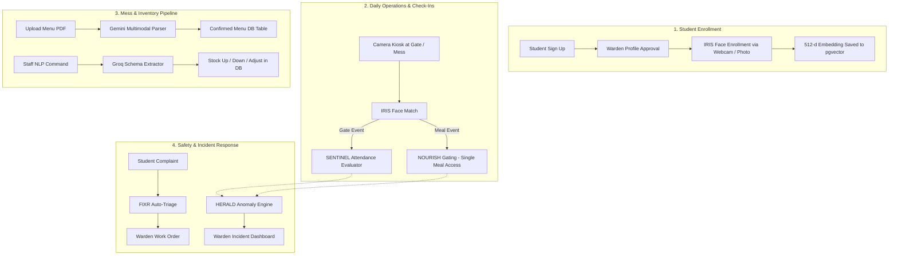

# Project Summary: Autonomous Multi-Agent Hostel Management System

---

## 1. Executive Summary & Project Overview (What We Are Doing)

This project is an **Autonomous Multi-Agent AI System for Smart Hostel Administration**. It transforms conventional, error-prone hostel management (paper logs, manual register entry, siloed complaint spreadsheets, and estimated mess rations) into an integrated, proactive ecosystem. 

Rather than relying on a passive CRUD database application, the system deploys **five specialized, autonomous AI agents** that observe physical events (face recognition at gates and mess dining halls), reason over text and documents (multimodal menu PDF extraction, NLP maintenance complaint triage, and conversational inventory commands), and cross-correlate student activities to detect safety anomalies in real time.

```
       ┌─────────────────────────────────────────────────────────┐
       │                HERALD (Orchestrator Agent)              │
       │  Cross-Agent Anomaly Detection & Daily Safety Digests   │
       └────────────────────────────┬────────────────────────────┘
                                    │ Coordinates
        ┌──────────────┬────────────┴───────────┬──────────────┐
        ▼              ▼                        ▼              ▼
   ┌─────────┐   ┌────────────┐          ┌─────────────┐  ┌──────────┐
   │  IRIS   │   │  SENTINEL  │          │   NOURISH   │  │   FIXR   │
   │ Vision  │   │ Attendance │          │ Mess Engine │  │ Triage   │
   └─────────┘   └────────────┘          └─────────────┘  └──────────┘
```

---

## 2. Problem Statement & Motivation (Why We Are Building It)

Traditional university hostels encounter four fundamental operational friction points:

1. **Proxy Attendance & Gate Insecurity**: Manual register signing and RFID cards are vulnerable to buddy-punching, physical card sharing, and lack of verified entry timestamps.
2. **Mess Inefficiency & Food Waste**: Kitchen managers estimate cooking quantities blindly without structured digital menus, leading to either food shortages or massive wastage. Menu parsing from physical rosters is manual, and tracking ingredient stocks requires tedious manual calculations.
3. **Delayed Maintenance Ticketing**: Student complaints (plumbing leaks, electrical hazards, broken furniture) are logged informally or across chat groups without automated urgency assessment or technician routing.
4. **Siloed Information & Safety Blindspots**: Gate attendance, mess check-ins, and student approvals reside in disconnected systems. If a student skips meals, misses night curfew, or exhibits concerning absence patterns, wardens only discover it days later.

---

## 3. Technology Stack & Tools (What We Are Using)

The project leverages a modern, low-latency, and AI-native stack:

| Component | Technologies Used | Purpose |
|---|---|---|
| **Backend Framework** | **Python 3.11+ / FastAPI** | High-performance asynchronous REST API, ASGI runtime, request routing |
| **Database & Vector Search** | **Supabase (PostgreSQL 15 + `pgvector`)** | Relational schema + 512-dimensional vector index for cosine similarity facial search |
| **Authentication & RBAC** | **Supabase Auth + JWT** | Role-Based Access Control (`student`, `warden`, `mess_staff`, `admin`) |
| **Computer Vision Engine** | **DeepFace (`Facenet512` + OpenCV Haar/RetinaFace)** | 512-d biometric face embedding extraction, live camera stream processing |
| **Multimodal Vision LLM** | **Google Gemini (3.5 Flash / Flash Lite / 2.0)** | Direct extraction of tables, dishes, and per-head ingredient ratios from PDF rosters |
| **Fast Structured NLP** | **Groq API (`llama-3.3-70b-versatile` / `llama-3.1-8b`)** | Sub-second JSON schema extraction for maintenance complaints and mess NLP commands |
| **Task Scheduling** | **APScheduler** | Timed background jobs (night curfew evaluation, defaulter lists, daily warden digest) |
| **Frontend Web Portal** | **React (Vite) + Tailwind CSS + Lucide Icons** | Responsive, glassmorphic dashboards for Students, Wardens, and Mess Staff |
| **Kiosk Client** | **Python OpenCV Kiosk (`camera_client/`)** | Local hardware capture client for physical gate and dining hall entry kiosks |

---

## 4. Multi-Agent Architecture (How the Agents Operate)

The system delegates responsibilities across specialized agents:

### 1. IRIS (Vision & Biometrics Agent)
* **Function**: Handles student facial enrollment and real-time gate/mess recognition.
* **Mechanism**: Generates a 512-float vector via `Facenet512`. Queries Supabase via `match_face()` RPC using vector cosine distance (threshold $\le 0.55$). Supports anti-spoofing and multi-frame averaging during enrollment.

### 2. SENTINEL (Gate & Attendance Agent)
* **Function**: Enforces gate policies, movement logging, and curfew rules.
* **Mechanism**: Logs biometric events (`entry` vs. `exit`). Classifies status into `present`, `late_entry`, or `curfew_violation`. At 22:00 IST every night, an automated scheduler marks all students without an entry record as `absent` and compiles a Defaulters List.

### 3. NOURISH (Mess & Inventory Agent)
* **Function**: Oversees meal access, menu digitalization, and kitchen inventory.
* **Mechanism**:
  * **Multimodal Menu Reader**: Uploaded weekly PDF menus are processed via Gemini to extract structured daily schedules and per-dish ingredients.
  * **Smart Inventory Management**: Maintains real-time ingredient levels (`quantity_available`, `reorder_threshold`).
  * **Conversational NLP Bar**: Kitchen staff can type natural language commands (e.g., *"Added 25 kg basmati rice"* or *"Issued 5L cooking oil"*), parsed by Groq/Gemini into atomic inventory updates with synonym normalization (`chawal` $\rightarrow$ `rice`).

### 4. FIXR (Maintenance & Complaint Agent)
* **Function**: Automatic triage and resolution tracking for infrastructure issues.
* **Mechanism**: When a student reports an issue (e.g., *"Water dripping from ceiling in room 302"*), FIXR classifies category (`plumbing`, `electrical`, `carpentry`), assigns priority (`urgent`, `medium`, `low`), and generates an estimated turnaround time for warden assignment.

### 5. HERALD (Orchestrator & Anomaly Sentinel)
* **Function**: Cross-agent reasoning and student welfare intelligence.
* **Mechanism**: Compares SENTINEL gate logs against NOURISH meal check-ins. If a student is inside the hostel but misses 3 consecutive meals or shows erratic movement patterns, HERALD flags a welfare anomaly for warden inspection.

---

## 5. System Workflow & Methodology (How It Works End-to-End)



### Operational Lifecycle:
1. **Student Onboarding**: The student registers $\rightarrow$ Profile requires Warden approval $\rightarrow$ Student captures facial profile $\rightarrow$ Biometric embedding stored in Supabase `face_embeddings`.
2. **Kiosk Recognition**: Physical cameras capture entry frames $\rightarrow$ FastAPI queries `match_face` $\rightarrow$ If matched, event logged in seconds with identity verification.
3. **Menu & Supply Cycle**: Warden/Mess staff uploads weekly PDF $\rightarrow$ Gemini extracts dishes and ingredient breakdowns $\rightarrow$ Staff updates inventory manually or via the NLP Command Bar.
4. **Automated Audits**: Scheduled background jobs run every evening to aggregate attendance, flag defaulters, and generate safety digests.

---

## 6. What Has Been Done Yet (Implemented Features)

### ✅ Core Backend & Infrastructure
- [x] Full FastAPI application architecture with modular agent routers (`/iris`, `/sentinel`, `/nourish`, `/fixr`, `/herald`).
- [x] Supabase PostgreSQL database schema with `pgvector` extension and `match_face` cosine similarity RPC function.
- [x] Unified Supabase Auth integration with local HS256 JWT validation and remote fallback.

### ✅ Agent Implementations
- [x] **IRIS**: DeepFace `Facenet512` model warm-up, single photo and multi-frame webcam enrollment, cosine distance recognition.
- [x] **SENTINEL**: Gate entry/exit logging, curfew enforcement, and APScheduler defaulters job.
- [x] **NOURISH**: Multimodal PDF menu parsing with a 5-tier Gemini model fallback chain (`3.5-flash-lite`, `3.5-flash`, `flash-latest`, `2.0-flash`, `1.5-flash`), extended 120s timeouts, full inventory CRUD, and Groq/Gemini-powered NLP command parser with synonym matching.
- [x] **FIXR**: LLM-based complaint categorization (`plumbing`, `electrical`, etc.) and severity scoring via structured outputs.
- [x] **HERALD**: Multi-agent cross-correlation query detecting students missing both gate events and meal check-ins.

### ✅ Frontend Portals (React + Vite)
- [x] **Role-Based Authentication UI**: Sign-up, Sign-in, route guards, and automatic token refresh/cleanup.
- [x] **Student Portal**: Dashboard, Profile & Biometric Face Enrollment, Attendance History, and Maintenance Complaint Submission.
- [x] **Warden Portal**: Operations Dashboard, Student Approval Management, Defaulters List, Gate Kiosk View, and Anomaly Monitoring.
- [x] **Mess Staff Portal**: Kitchen Dashboard, Live Inventory Management (with datalist autocomplete and stock indicators), NLP Conversational Command Bar, and PDF Menu Uploader with live elapsed timer.

---

## 7. What Is Pending & Future Scope (Roadmap)

While the core functionality and portals are operating, the following enhancements represent the final development frontier:

| Milestone / Feature | Current Status | Description & Recommended Next Step |
|---|---|---|
| **1. Dynamic Meal Head Counts** | 🟡 Next Up | Dynamically pull live meal headcount from morning IRIS attendance logs, with a manual override counter on the Mess Dashboard. |
| **2. Menu $\leftrightarrow$ Inventory Alerting** | 🟡 Next Up | Automatically cross-check current stock against today's parsed menu ingredients and trigger high-priority alerts for impending food shortages. |
| **3. Automated Meal Depletion** | 🟡 Next Up | Implement a **"Mark Meal as Served"** one-click button that deducts required ingredient quantities (`head_count × ingredient_ratio`) from inventory. |
| **4. Hardware Kiosk Deployment** | ⏳ Planned | Package `camera_client/capture.py` into a lightweight, plug-and-play kiosk installer for Raspberry Pi / mini-PC touchscreens at dining hall turnstiles. |
| **5. WhatsApp / Email Alert Delivery** | ⏳ Planned | Integrate Twilio or SendGrid to dispatch immediate notifications to parents/wardens when a curfew violation or welfare anomaly is flagged. |

---

## 8. Summary & Key Takeaways

1. **True Multi-Agent Paradigm**: Tasks are not lumped into a monolithic controller; specialized agents (IRIS, SENTINEL, NOURISH, FIXR, HERALD) handle vision, time rules, multimodal extraction, NLP, and cross-system reasoning independently.
2. **Robust Real-World Reliability**: High-latency multimodal LLM calls are hardened with 5-tier fallback chains and client timeouts, preventing server hang-ups.
3. **End-to-End Coverage**: The solution spans physical hardware camera feeds, cloud database vector indexing, role-based web dashboards, and background schedulers.
